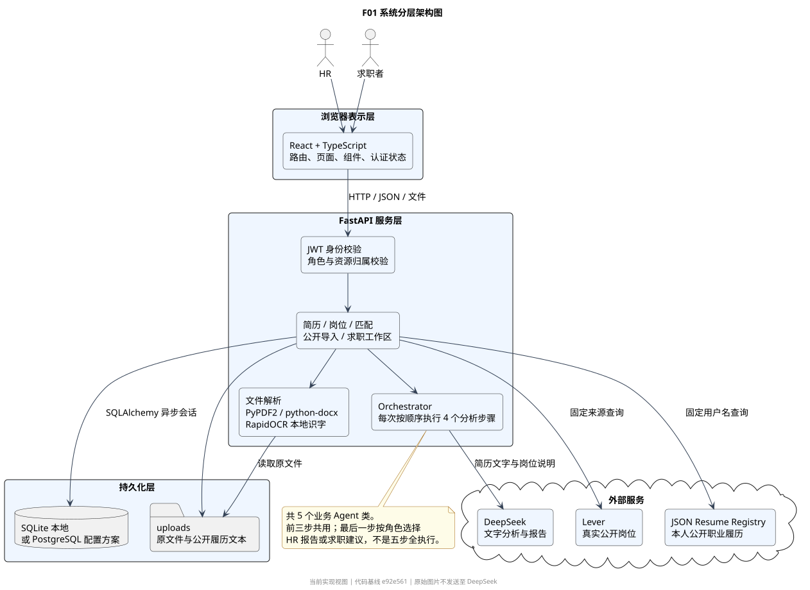
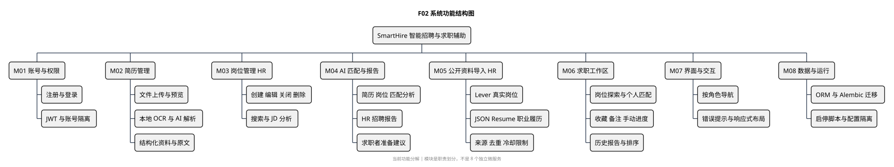
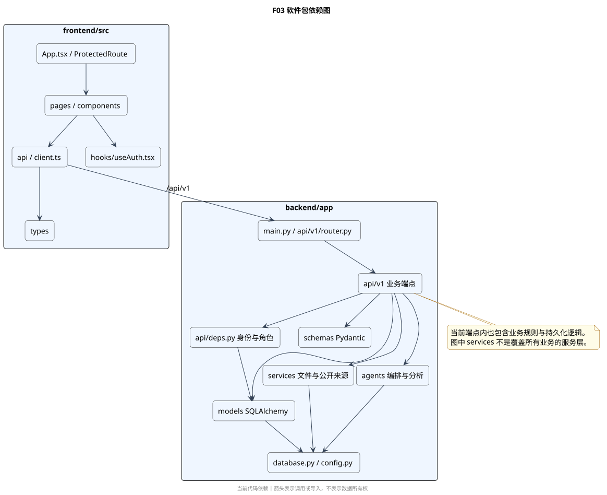
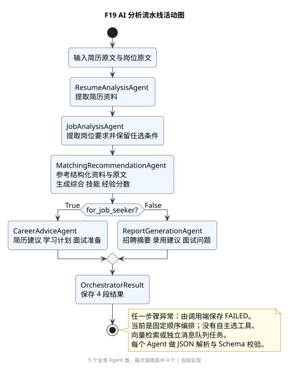
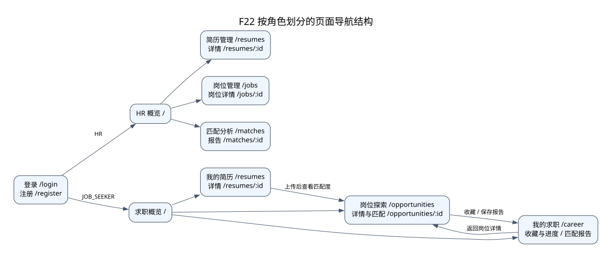
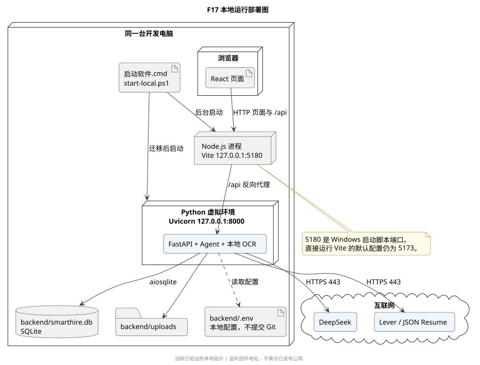
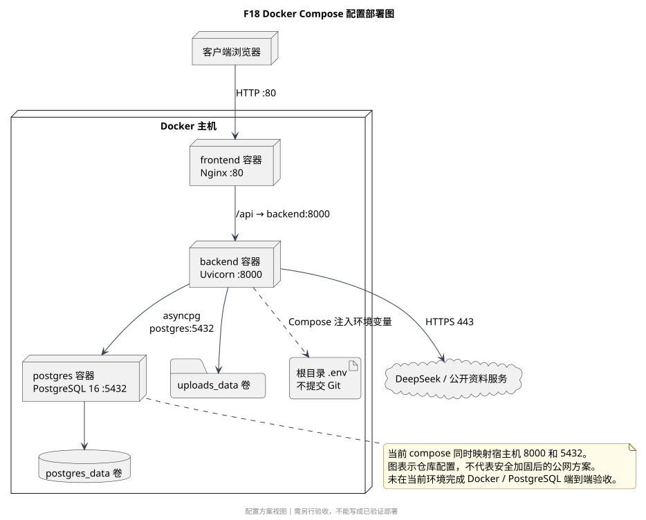

# 系统架构与模块结构说明

代码基线：`e92e561`。架构采用浏览器前端与 Python 后端分离的方式；后端是一个 FastAPI 应用，模块分工不等于微服务拆分。运行数据由关系数据库和上传目录分别保存，AI 通过外部 DeepSeek API 提供文字分析能力。

## 系统分层

**图 F01 是什么：**系统架构图。它回答“软件由哪些层组成、哪些数据在本机、哪些处理依赖外部服务”，不表示用户点击顺序。身份依赖、端点中的业务规则、文件解析与 Agent 编排共同构成后端业务实现。

## 模块职责与代码入口

| 编号与模块 | 职责、输入与输出 | 核心代码入口 | 主要数据与依赖 |
|---|---|---|---|
| M01 账号与权限 | 输入注册资料或令牌；输出身份、角色或拒绝结果 | [auth.py](../../backend/app/api/v1/auth.py)、[deps.py](../../backend/app/api/deps.py)、[services/auth.py](../../backend/app/services/auth.py)、[useAuth.tsx](../../frontend/src/hooks/useAuth.tsx) | users；JWT；密码散列；后端角色与所有权检查 |
| M02 简历管理与解析 | 输入本人文件；输出原文、解析资料、预览或下载内容 | [resumes.py](../../backend/app/api/v1/resumes.py)、[resume_parser.py](../../backend/app/services/resume_parser.py)、[Resumes.tsx](../../frontend/src/pages/Resumes.tsx)、[ResumeDetail.tsx](../../frontend/src/pages/ResumeDetail.tsx) | resumes 与 5 类子表、uploads；本地 OCR；可选 AI |
| M03 岗位管理 | 输入 HR 岗位资料与筛选条件；输出本人岗位、结构化要求 | [jobs.py](../../backend/app/api/v1/jobs.py)、[Jobs.tsx](../../frontend/src/pages/Jobs.tsx)、[JobDetail.tsx](../../frontend/src/pages/JobDetail.tsx) | jobs、job_requirements；JobAnalysisAgent |
| M04 AI 匹配与报告 | 输入简历与岗位原文；输出分数、差距和角色化报告 | [orchestrator.py](../../backend/app/agents/orchestrator.py)、[base.py](../../backend/app/agents/base.py)、[matches.py](../../backend/app/api/v1/matches.py)、[career.py](../../backend/app/api/v1/career.py) | match_reports；DeepSeek；JSON Schema 校验 |
| M05 公开资料导入 | 请求固定公开来源，净化、去重、保留来源并写入 HR 工作区 | [imports.py](../../backend/app/api/v1/imports.py)、[public_sources.py](../../backend/app/services/public_sources.py)、[SourceInfo.tsx](../../frontend/src/components/SourceInfo.tsx) | Lever、JSON Resume；source_name / source_url / imported_at |
| M06 求职工作区 | 提供在招岗位探索、本人匹配、收藏、备注、手动进度和历史报告 | [career.py](../../backend/app/api/v1/career.py)、[CareerJobs.tsx](../../frontend/src/pages/CareerJobs.tsx)、[CareerJobDetail.tsx](../../frontend/src/pages/CareerJobDetail.tsx)、[Career.tsx](../../frontend/src/pages/Career.tsx) | 读取公开 ACTIVE 岗位；本人 Resume；saved_jobs；个人报告 |
| M07 页面与交互 | 页面布局、按角色导航、加载与失败反馈、API 客户端 | [App.tsx](../../frontend/src/App.tsx)、[Layout.tsx](../../frontend/src/components/Layout.tsx)、[Sidebar.tsx](../../frontend/src/components/Sidebar.tsx)、[client.ts](../../frontend/src/api/client.ts) | React 状态与 localStorage 登录令牌；前端权限只是入口控制 |
| M08 数据与运行支持 | 配置读取、会话管理、迁移、依赖锁定与本地启停 | [database.py](../../backend/app/database.py)、[config.py](../../backend/app/config.py)、[alembic](../../backend/alembic)、[start-local.ps1](../../scripts/start-local.ps1)、[stop-local.ps1](../../scripts/stop-local.ps1) | SQLite / PostgreSQL；uv / npm；进程状态文件 |

**图 F02 是什么：**功能结构图。它说明各模块“负责什么”，不是执行时间线。模块之间存在复用：例如 M06 的匹配复用 M04，M02 和 M05 共用简历持久化结构。该图较宽，报告可使用横向页面，或在讲解时拆分 HR 与求职者两部分。

**图 F03 是什么：**软件包依赖图。箭头表示代码导入或调用。当前 `api/v1` 内也包含业务判断和数据操作，不宜把它描述成已经完全分离的 Controller–Service–Repository 三层架构。

## AI 模块内部结构

| 类 | 输入 | 输出 | 执行条件 |
|---|---|---|---|
| ResumeAnalysisAgent | 简历文字 | 人物摘要、技能、教育与经历、优势不足等 | 每次完整匹配第 1 步；也可单独解析简历 |
| JobAnalysisAgent | 岗位说明 | 技能要求、任选关系、经验与教育要求 | 第 2 步；也可单独分析岗位 |
| MatchingRecommendationAgent | 前两步结果与原文 | 综合 / 技能 / 经验分数、匹配与缺失技能、差距 | 第 3 步 |
| ReportGenerationAgent | 前三步结果 | HR 摘要、招聘建议、面试建议与追问 | 第 4 步，`for_job_seeker=False` |
| CareerAdviceAgent | 前三步结果与原文 | 个人摘要、简历修改、学习计划、面试准备 | 第 4 步，`for_job_seeker=True` |

**图 F19 是什么：**AI 控制流程活动图。5 个业务 Agent 类中，前三个固定调用，最后两个二选一，所以一次完整匹配仍是 4 步。`BaseAgent` 负责惰性创建 LLM 客户端、构造 JSON 输出要求、解析与 Pydantic 校验；连续无效输出或服务错误会抛出异常。

这是固定顺序的分析流水线。函数中虽保留 `rag_query` 参数，但当前没有向量检索实现；不能写成已经接入 RAG、Chroma 或 Agent 自主选工具。也没有 Celery、独立后台任务队列或 WebSocket 进度推送。

## 页面与交互结构

**图 F22 是什么：**UI 导航图。当前有 12 个页面组件；首页、简历列表与详情按角色复用，HR 与求职者的专属页面由 `ProtectedRoute` 控制。所有真正的权限判断仍需后端执行。

| 页面组 | 主要页面 | 用户任务 | 报告中应采集的截图 |
|---|---|---|---|
| 公共入口 | Login / Register | 选择角色、登录 | 登录页、注册角色选择 |
| 通用资料 | Dashboard / Resumes / ResumeDetail | 上传与核对自己的资料 | 按角色首页、上传入口、OCR 原文与解析资料 |
| HR 管理 | Jobs / JobDetail / Matches / MatchDetail | 管理岗位、批量比较候选人 | 带来源岗位、选择简历、完成 / 失败报告 |
| 求职端 | CareerJobs / CareerJobDetail / Career | 查找岗位、个人匹配、记录进度 | 搜索结果、三项分数与建议、收藏进度、历史报告 |

截图必须来自实际运行页面，并标明所用数据是虚构演示数据还是公开参考履历；不要显示真实密钥、登录令牌和私人联系方式。

## 网络与部署边界

**图 F17 是什么：**本地部署图。Windows 启动脚本使用 `127.0.0.1:5180` 的 Vite 与 `127.0.0.1:8000` 的 Uvicorn；`/api` 由前端开发服务器代理。直接运行 Vite 时默认端口仍是 5173。原文件在 uploads，SQLite 文件在 backend；这些目录与本地 `.env` 不提交 Git。

外部 DeepSeek 和公开资料服务使用 HTTPS。OCR 在本机运行，但开启 AI 后识别出的简历文字和岗位说明会发送至 DeepSeek。该图描述单机运行，没有假设已经具备公网域名、TLS 终止、生产备份或跨机网络访问能力。

**图 F18 是什么：**仓库中的 Docker 配置拓扑，**不是已完成验收的部署结果**。Nginx 对外 80、后端 8000、PostgreSQL 5432，容器通过服务名通信；根目录 `.env` 由 Compose 注入，区别于本地后端读取 `backend/.env`。当前配置还映射了数据库与后端宿主端口，不能直接把它写成已经加固的生产网络方案。

## 维护入口

修改需求时，先确认模块与边界，再检查页面、端点、Schema、ORM、迁移和测试是否都需要更新。涉及 AI 输出的变更还应检查前端字段展示与失败状态，避免仅改提示词却遗漏界面或持久化结构。源项目归属见 [UPSTREAM.md](../../UPSTREAM.md)，当前许可证声明见 [README](../../README.md#许可证)；报告应明确区分继承能力与本轮增量工作，正式分发时还应核对上游许可证材料。
