# 业务流程与图表说明

代码基线：`e92e561`。本章把不同图的含义分开：DFD 表达数据从哪里来、经什么处理、保存到哪里；UML 顺序图表达调用先后；状态图描述某个对象的状态变化；活动图表达处理步骤与判定分支。它们不能互相替代。

## 分层数据流图

### F04 顶层 DFD

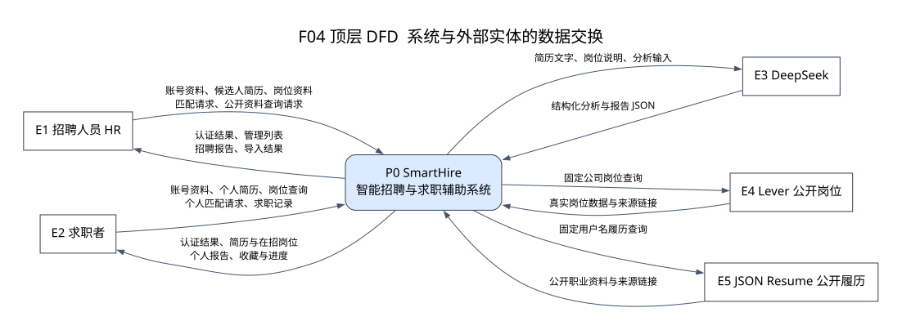

**用途：**说明 SmartHire 的系统边界与 5 类外部实体。E1 是 HR，E2 是求职者，E3 是 DeepSeek，E4 是 Lever，E5 是 JSON Resume。P0 表示整个系统；顶层不展开内部表与处理细节。

图中的“简历文字、岗位说明”会发送给 DeepSeek；原始图片不经过这条数据流。公开岗位与公开履历来自各自的查询响应，不是由大模型编造。

### F05 一层 DFD

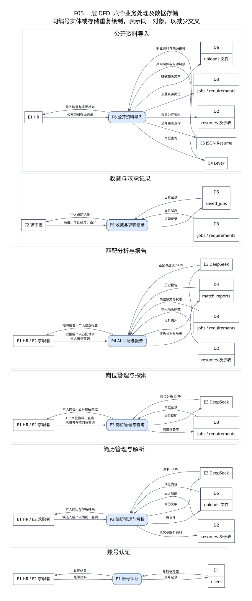

**用途：**把 P0 分成 P1 账号认证、P2 简历管理、P3 岗位管理与查询、P4 匹配报告、P5 求职记录和 P6 公开导入。圆角框是处理；E 编号矩形是外部实体；带 D 编号的分隔框是逻辑数据存储。存储可含多张物理表，见下表。

为减少跨线，**同编号的实体或存储可以在图中重复出现，仍表示同一个对象**。六个分区是阅读分组，不是六个独立系统，也不是时间步骤。

| 存储编号 | 逻辑内容 | 实现 |
|---|---|---|
| D1 | 用户资料与身份 | users |
| D2 | 简历原文与结构化子资料 | resumes、educations、skills、projects、work_experiences、certificates |
| D3 | 岗位与需求条目 | jobs、job_requirements |
| D4 | 分析状态、分数与报告 | match_reports |
| D5 | 私有收藏、备注和进度 | saved_jobs |
| D6 | 上传文件和公开履历文本 | uploads 文件目录，不是数据库表 |

### F06 二层 DFD

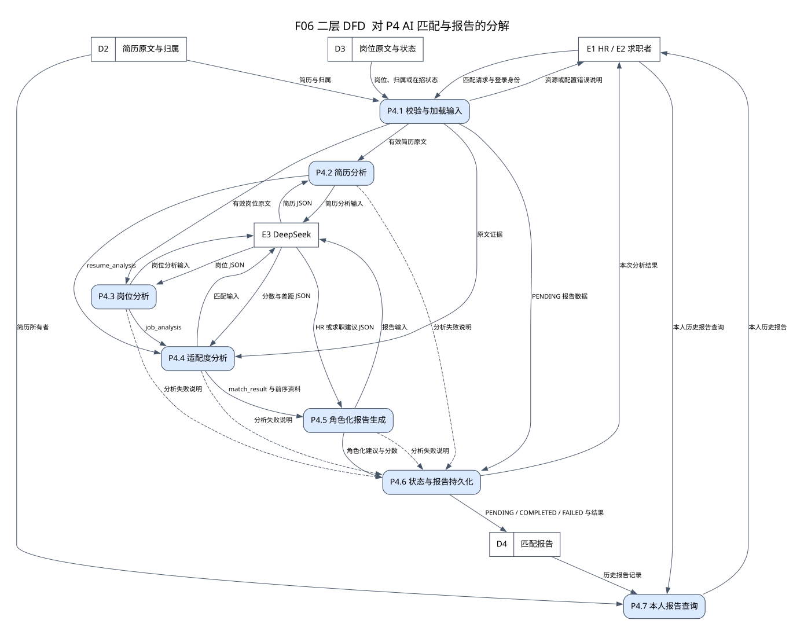

**用途：**只细化 P4，不把其他模块重新画一遍。P4.1 校验并加载原文，P4.2 / P4.3 分析简历与岗位，P4.4 产生分数和差距，P4.5 按角色生成报告，P4.6 持久化状态，P4.7 读取本人历史。失败说明也是数据流，不能只画成功结果。

DFD 的数据依赖不意味着步骤可以并行执行；实际程序先做简历分析再做岗位分析，调用顺序见 F11、F12。P4.1 到 P4.6 的 PENDING 数据流用于说明报告初始状态；并非一份新的岗位或简历资料。

### 层间数据平衡

| 顶层输入或输出 | 一层承接处理 | P4 二层承接 |
|---|---|---|
| 账号资料与认证结果 | P1 | 不属于 P4 的分解 |
| 简历上传、原文与解析资料 | P2 | P4 只从 D2 读取已有原文 |
| 岗位管理与在招岗位查询 | P3 | P4 只从 D3 读取岗位 |
| 匹配请求与招聘 / 个人报告 | P4 | P4.1 输入，P4.6 本次输出，P4.7 历史输出 |
| 收藏、手动进度与个人记录 | P5 | 不属于 P4；不会写成招聘方反馈 |
| 公开来源查询与导入结果 | P6 | 不属于 P4；导入后资料通过 D2 / D3 被读取 |
| DeepSeek 输入与结构化输出 | P2 / P3 / P4 | P4.2–P4.5 与 E3 交换分析数据 |

这是面向课程的逻辑 DFD；处理编号不与 Python 文件一一对应。例如 `/career/jobs` 在代码上位于 `career.py`，在逻辑数据处理上归入 P3 岗位查询。

## UML 用例图

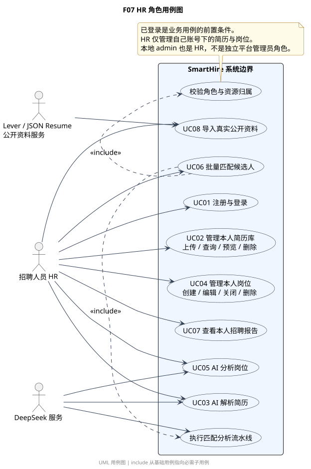

**图 F07：**描述 HR 的使用目标，重点是本人资源管理、公开资料导入和候选人匹配。登录是业务前置条件，不必把“登录”画成每次操作都实际执行的 include 子流程。批量匹配必需的资源校验与分析流水线使用 include。

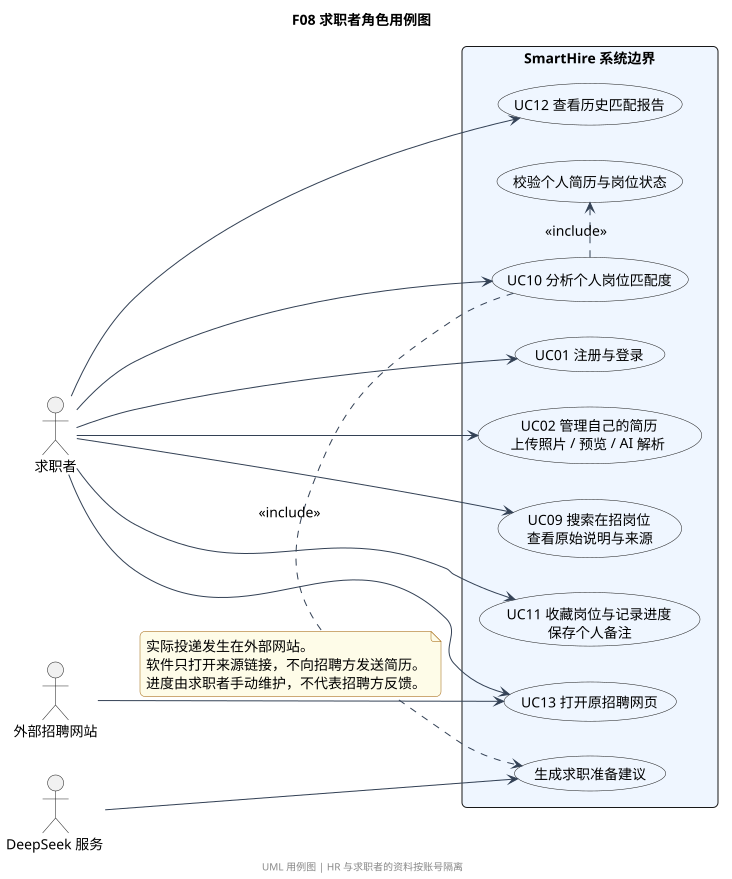

**图 F08：**描述求职者自己的目标。外部招聘网页在系统边界外，软件内部用例只是打开原站链接。正式投递、实际面试和录用沟通不属于平台内已实现的流程。UC 编号和前后置条件见 [需求说明](01-scope-and-requirements.md#典型用例说明)。

## UML 顺序图

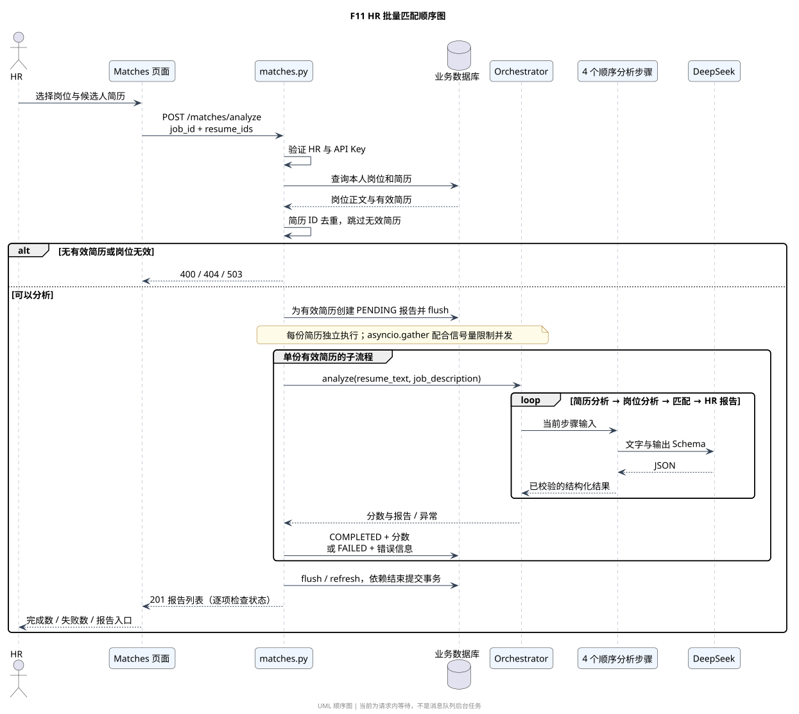

**图 F11：**展示 HR 请求中的单份有效简历子流程。完整批次会去重、跳过无效简历，并用 `asyncio.gather` 与信号量控制并发；并不是串行逐份等待。批量响应返回后仍要检查每份报告的 status，HTTP 201 不保证所有分析成功。

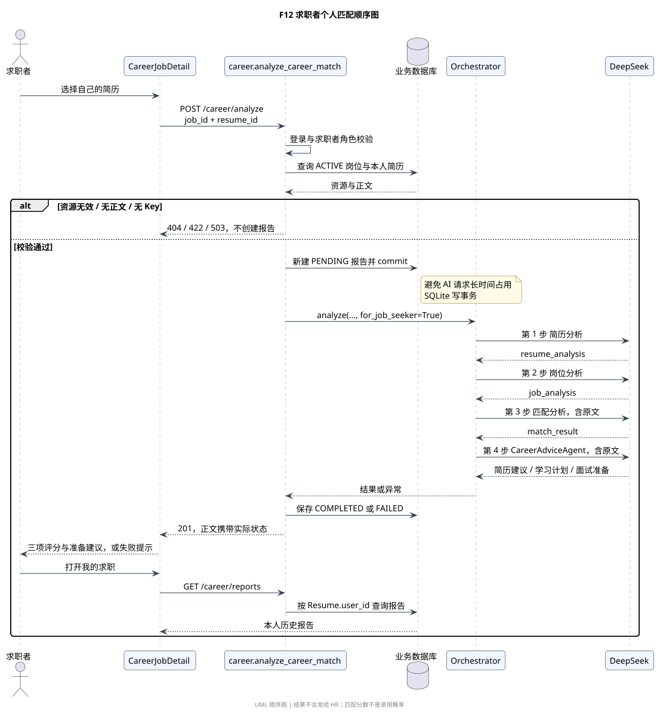

**图 F12：**展示个人匹配。与 HR 端不同，求职者可以使用其他 HR 发布的 ACTIVE 岗位，但简历必须属于本人。待分析记录先提交，再调用 AI，减少 SQLite 长事务占用；最后一步使用 CareerAdviceAgent。查询历史通过 Resume.user_id 判断归属，岗位发布者不能因此读取求职者报告。

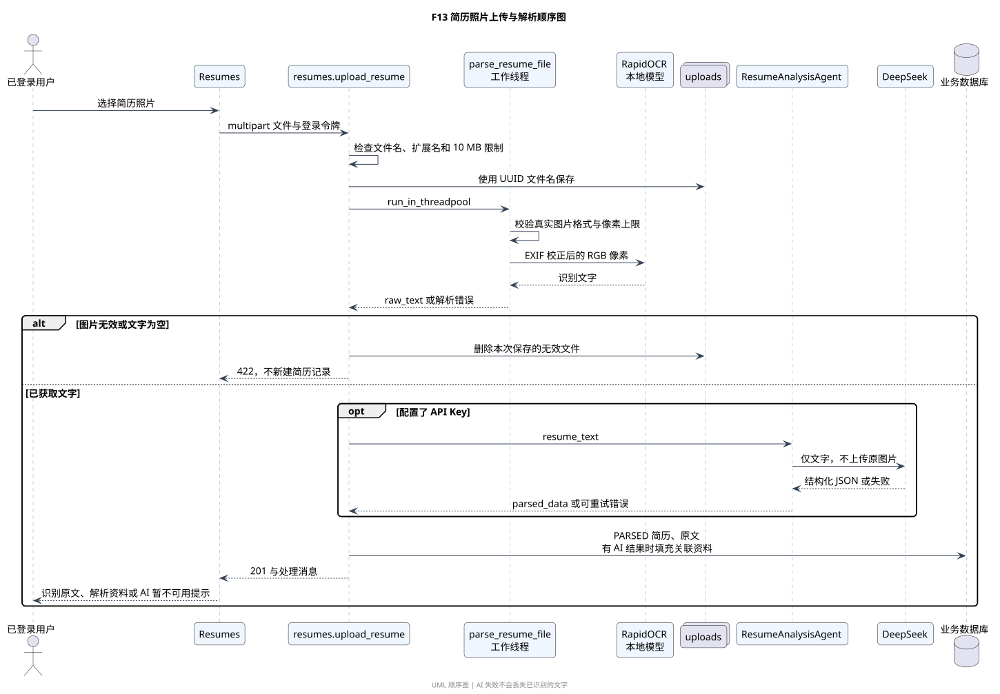

**图 F13：**展示浏览器、上传端点、工作线程、本地 OCR、AI 和持久化之间的交互。识字和语义分析是不同步骤：OCR 本地提取文字，DeepSeek 再分析文字。原文提取成功时，AI 失败不会导致该简历丢失。

## UML 状态图

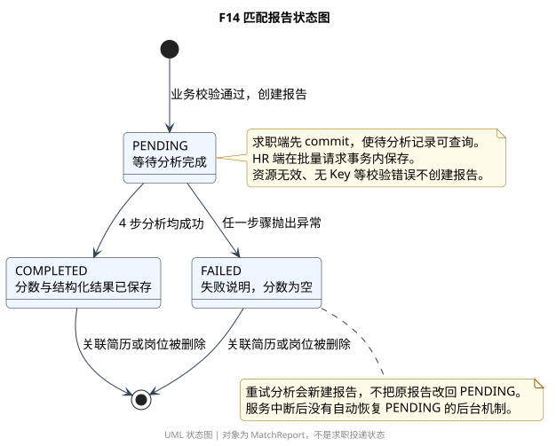

**图 F14：**建模对象是 MatchReport。只有业务校验通过后才创建 PENDING；4 步成功变为 COMPLETED，异常变为 FAILED。重试会创建新报告；不存在自动恢复挂起任务的机制。进程中断可能留下 PENDING，不能宣称系统已经实现断点续跑。

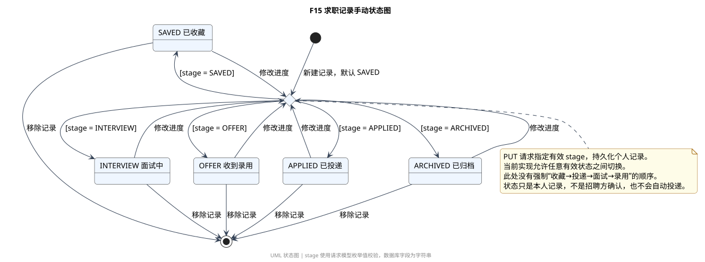

**图 F15：**建模对象是 SavedJob。五个 stage 允许由用户直接切换，没有强制线性招聘流程。移除收藏记录不等于撤回外站投递，也不会删除已存在的匹配报告。岗位或简历删除导致报告清理属于其他对象的生命周期。

简历的 PARSED 只表示原文解析成功。AI 未配置或暂时失败时仍可能是 PARSED；非法文件通常返回错误并不新建记录。虽然 ResumeStatus 定义了 PENDING、PARSED、FAILED，也不能据此虚构当前没有实现的状态迁移。

## UML 活动图

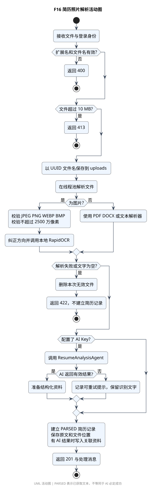

**图 F16：**用于课程“选一个模块画活动图或流程图”的要求。它重点表达文件与图片校验、OCR、可选 AI 和错误分支。与 F13 相比，它不强调服务对象的调用先后，而强调控制分支。

AI 流水线的另一张活动图为 [F19](diagrams/svg/F19-ai-pipeline.svg)，解释见 [架构与模块](02-architecture-and-modules.md#ai-模块内部结构)。图源和两种图片格式都可从 [图表总目录](README.md#图表目录) 下载。
