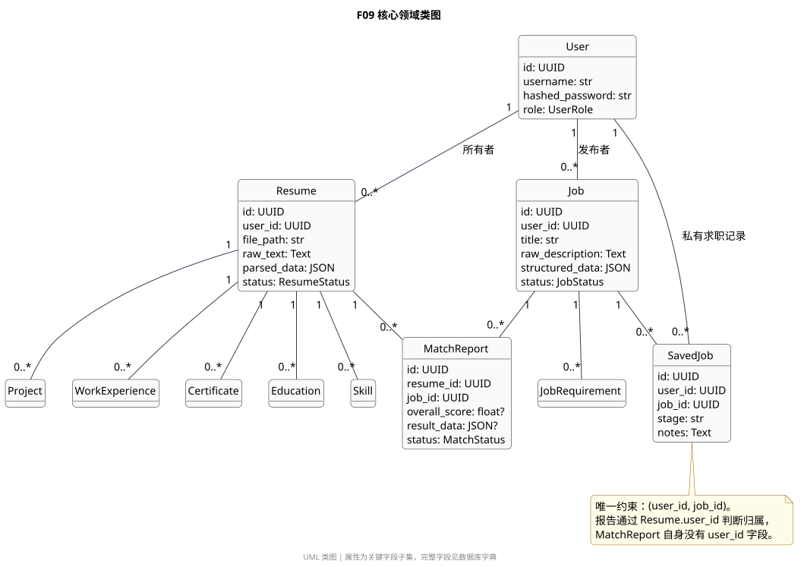
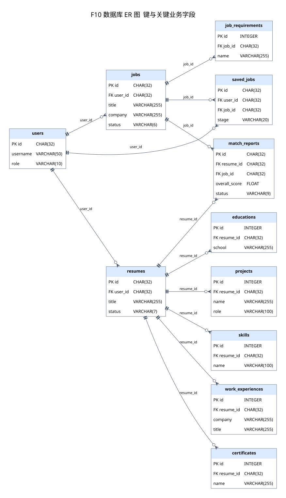

# 数据库与接口设计说明

代码基线：`e92e561`。数据库采用关系模型保存账号、简历结构、岗位、报告与求职记录，原始文件另存 uploads。表结构来自 SQLAlchemy 模型与 Alembic 迁移；本章不导出任何真实账号或简历内容。

## 概念模型与关系模型



**图 F09 是什么：**UML 领域类图。它关注软件中的对象与关联，不是完整数据库字段表。User 拥有简历、岗位和私有求职记录；MatchReport 关联一份简历和一个岗位，不直接存 user_id。



**图 F10 是什么：**数据库实体关系图。它显示表、主外键和一对多关系。每条父到子的关系表示“子记录必须关联一个父对象，父对象可有零到多条子记录”；当前 SQLite 引擎未显式开启外键 PRAGMA，物理约束强制性不能只凭图推断。完整字段、默认值、枚举和可空性见 [数据库字段字典](reference/database-dictionary.md)。

| 表 | 业务含义 | 设计说明 |
|---|---|---|
| users | 登录账号、角色和启用状态 | username / email 唯一，保存密码散列而非明文 |
| resumes | 原文、结构化 JSON、文件位置和来源 | user_id 决定资源归属；来源字段可空 |
| educations | 简历教育经历 | 多条经历关联同一简历 |
| skills | 简历技能 | 与简历一对多；不是全站共享技能词典 |
| projects | 简历项目经历 | tech_stack 为 JSON；项目名称、角色和说明单独保存 |
| work_experiences | 简历工作经历 | 保存起止时间和 is_current |
| certificates | 证书模型 | 模型存在，当前解析填充函数没有写入循环，自动提取不完整 |
| jobs | HR 岗位正文、结构化要求、状态、职级和来源 | ACTIVE 岗位可在求职端探索；导入职级缺失用 UNSPECIFIED |
| job_requirements | 岗位的结构化要求条目 | category / importance / is_mandatory |
| match_reports | 关联简历与岗位的分析结果 | 分数可空，result_data 保存各步骤结果或失败信息 |
| saved_jobs | 本人收藏、个人备注和手动求职进度 | `(user_id, job_id)` 联合唯一；stage 由请求模型校验 |

`alembic_version` 是迁移工具维护的版本表，不计入上述 11 张业务表。当前迁移链为：`e7d1808793e6` 初始建表 → `db7349f82947` 岗位职级 → `c71a9d2e4b80` 来源字段 → `e82b6c9a310f` 求职记录。

## 一致性与生命周期

- **所有权：**简历和 HR 岗位管理按 user_id 查询；报告归属通过关联简历判断。求职者能读取在招岗位不意味着能读取发布者的简历库。
- **删除：**ORM 对简历子表、关联报告和岗位收藏设置级联处理。岗位删除会清理相关匹配报告和收藏；移除收藏不会删除匹配报告。不能将 ORM 级联一概写成数据库 `ON DELETE CASCADE`。
- **再分析：**重新解析简历、重新分析岗位时显式删除旧关联资料再写入，避免重复和异步懒加载；报告重试则创建新报告。
- **公开导入：**按当前 HR 的来源 URL 查重并检查冷却时间。当前没有对 source_url 建全局唯一约束，也没有保证并发导入在所有环境下都绝不重复。
- **事务：**数据库依赖正常结束提交，异常回滚。求职匹配先提交 PENDING，再做耗时 AI；文件落盘与数据库事务不是一个分布式原子事务，不能宣称不存在孤立文件的任何可能。
- **记录快照：**报告 JSON 保存分析输出，但展示的岗位 / 简历标题仍可来自当前关联记录；没有完整的岗位版本历史和审计事件表。

## 数据量分析模型

下面是课程设计阶段的估算模型，**不是生产数据库实测**。实际平均大小、增长率和保留周期需要组员按真实样本测量。

设账号数为 U、简历数为 R、岗位数为 J、每简历平均技能数为 S、教育数为 E、工作经历数为 W、项目数为 P、证书数为 C、每岗位要求数为 Q、报告数为 M、收藏记录数为 B。

```text
关系记录总数 ≈ U + R × (1 + S + E + W + P + C) + J × (1 + Q) + M + B
数据库空间 ≈ 各表记录数 × 该表平均记录字节数之和 + 索引与页开销
文件空间 ≈ 上传文件数量 × 平均文件大小 + 公开履历文本大小
报告增长量 ≈ 每日匹配次数 × 平均 result_data 大小
总存储预算 ≈ 数据库空间 + 文件空间 + 备份空间
```

**仅作算术演示的假设：**U=100、R=300、J=200、S=10、E=2、W=3、P=2、C=0、Q=8、M=1000、B=500，则记录数约为 `100 + 300×18 + 200×9 + 1000 + 500 = 8800`。若平均文件 0.5 MiB，300 个文件约为 150 MiB；若每份报告 JSON 平均 20 KiB，1000 份约为 19.53 MiB。以上数值是明确的假设，不是用户数量、文件平均值或运行成果。

10 MB 是单文件上限，不能直接当作平均值。数据库还保留 raw_text、parsed_data 和 result_data，重复存储会影响空间；因此后续实测应分别统计文件、文本、报告和索引。未做容量测试前，不承诺“支持十万用户”或固定并发吞吐。

## API 设计

完整清单见 [30 个接口方法与路径](reference/api-inventory.md)。基础路径是 `/api/v1`，除注册、登录、健康检查外，业务接口依赖登录身份。

| 接口族 | 业务用途 | 当前主要规则 |
|---|---|---|
| `/auth`、`/users/me` | 注册、登录、当前账号读取与修改 | 无 refresh 端点；更新个人资料没有独立前端页面 |
| `/resumes` | 上传、查询、原文资料、文件预览、修改标题、删除和 AI 解析 | 只处理本人简历；文件接口兼容查询令牌 |
| `/jobs` | HR 岗位管理、搜索与 AI 分析 | 写操作 HR 限定；查询按本人岗位隔离 |
| `/matches` | HR 批量分析和本人报告查询 | 无效简历跳过；逐份保存失败状态 |
| `/imports` | 固定公开来源导入 | HR 限定、冷却、去重和来源标记 |
| `/career` | 在招岗位、个人匹配、收藏、备注、进度和个人报告 | 求职者限定；个人资料与报告不对 HR 自动公开 |

### 请求与结果示例

以下使用示意 UUID，**不是数据库中的真实记录**。

```json
{
  "job_id": "00000000-0000-0000-0000-000000000001",
  "resume_id": "00000000-0000-0000-0000-000000000002"
}
```

`POST /api/v1/career/analyze` 接收上述两个 UUID。成功建立报告后返回 201，并携带 `status`：COMPLETED 表示有实际结果；FAILED 表示分析失败，overall_score 为 null。不能只凭 201 判定 AI 成功。

`PUT /api/v1/career/saved/{job_id}` 可使用：

```json
{
  "stage": "SAVED",
  "notes": "先核对岗位要求，再准备真实项目案例。"
}
```

这只保存个人记录，不执行外站投递。字段约束、可空性与异常细节以 Pydantic 和业务代码为准。

| 状态码 | 代表含义 | 典型场景 |
|---|---|---|
| 400 | 业务输入不满足处理条件 | 不支持扩展名、HR 批次没有有效简历 |
| 401 | 身份不存在、过期或无效 | 未带登录令牌 |
| 403 | 角色不允许 | 求职者写 HR 岗位，HR 访问 career 入口 |
| 404 | 对当前用户不可见或不存在 | 他人简历、关闭且未收藏岗位 |
| 409 | 唯一字段冲突 | 注册同名用户名或邮箱 |
| 413 | 文件超限 | 超过 MAX_UPLOAD_SIZE |
| 422 | Schema 校验或解析失败 | 非法 stage、图片无可识别文字 |
| 429 | 当前类别导入冷却 | 一小时内重复同步 |
| 502 | 公开来源没有可用数据 | 不生成假的备用岗位或履历 |
| 503 | AI 配置缺失或部分主动 AI 调用失败 | 无 Key、服务不可用 |

### 三类 API 的职责

本地 REST API 连接网页与后端；DeepSeek API 负责语义分析和报告；Lever / JSON Resume API 提供可核验的公开资料。DeepSeek Key 只在后端配置中使用，原图识字不依赖识图 API。来源和公开资料使用边界见 [公开数据来源说明](../public-data-sources.md)。
