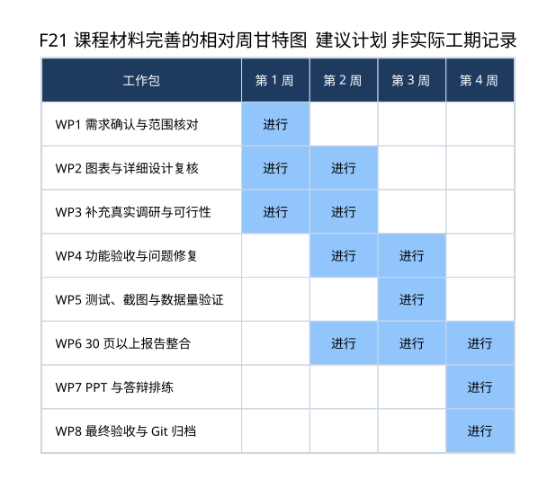
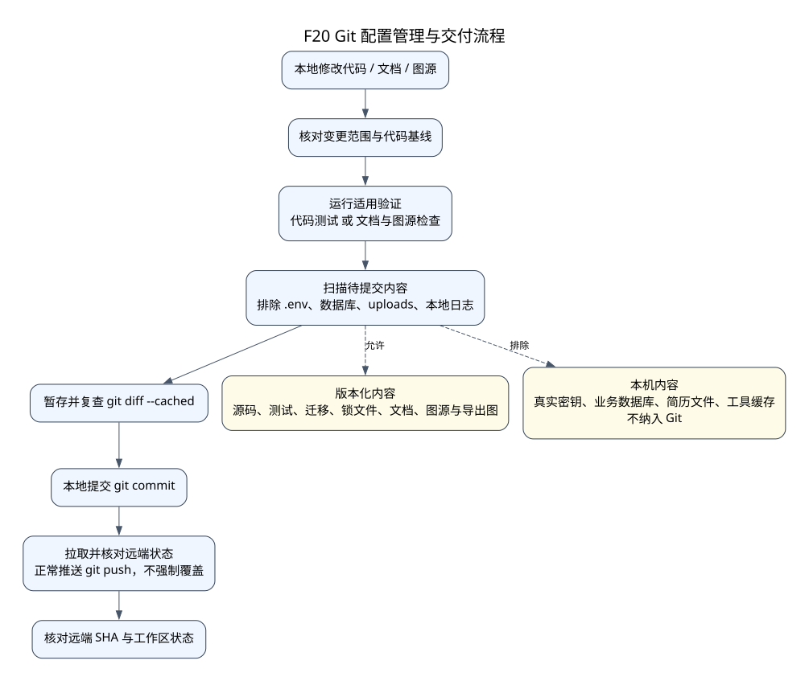

# 项目管理与交付材料

本章提供可填写的课程管理框架。代码现状基线为 `e92e561`；建议排期、人员分工、工作量和报价均不冒充已经发生的事实。真实姓名、学校截止日期、访谈材料和费用依据由项目组确认后填写。

## 生命周期模型建议

建议采用**迭代增量模型**：先确认角色与数据隔离，再交付简历和岗位基础管理，随后加入 AI 匹配、公开数据与求职工作区，每个增量都有可演示功能和相应测试。理由是 OCR 样本质量、模型返回和角色需求会影响设计，适合用短反馈迭代修正。

这是一种适合本项目的管理建议，不代表仓库从最早创建时就严格执行了该模型。当前项目继承了上游 SmartHire 代码，增量与复用范围需在 [UPSTREAM.md](../../UPSTREAM.md) 及最终报告中明确归属，不能把原项目全部成果记为本组从零实现。

建议每轮保留“需求变更→设计更新→代码与迁移→测试→演示→文档同步”的证据。只有 Git 提交不能完整证明某位成员投入的工时，应结合任务记录和真实分工。

## WBS 与计划

| 工作包 | 主要产出 | 前置条件 | 验收方式 |
|---|---|---|---|
| WP1 需求与边界 | 角色、用例、需求编号、待实现清单 | 课程要求、选定用户场景 | 组员确认需求与实际软件一致 |
| WP2 架构与数据设计 | 模块、DFD、UML、ER、字段与接口说明 | WP1 | 图表可渲染，说明能追到源码 |
| WP3 可行性与真实调研 | 用户资料、政策来源、经济和操作分析 | 确定调查对象与地区 | 链接、日期、访谈或问卷记录可核验 |
| WP4 功能修复与验收 | 可运行增量、迁移、原文与错误处理 | WP1 / WP2 | 对照需求操作与测试 |
| WP5 测试与取证 | 黑盒 / 白盒记录、截图、数据量样本 | 可运行软件 | 测试实际通过，截图不含密钥与私密数据 |
| WP6 报告整合 | 30 页以上正式报告与引用 | WP1–WP5 | 章节完整、图号统一、实现与规划分开 |
| WP7 PPT 与答辩 | 演示文稿、演示脚本、问题清单 | 报告初稿 | 限时排练与分角色演示 |
| WP8 发布与归档 | Git 版本、最终文件、环境说明 | 修订通过 | 从指定版本可复现，私密文件未提交 |



**图 F21 是什么：**相对周的建议甘特图，用于安排后续课程材料完善。它没有虚构日历日期，也不是实际历史工期。正式提交前，应替换为学校的真实时间窗口、任务负责人、依赖关系和完成情况；已经完成的代码不必按图重做。

## 分工填写模板

| 人员 | 建议负责范围 | 需要提交的独立证据 | 实际姓名 / 工作量 |
|---|---|---|---|
| 成员 A | 需求、可行性、资料来源与报告整合 | 需求确认、访谈与引用、章节修订 | 待填写 |
| 成员 B | 后端、数据模型、接口与 AI 分析 | 代码提交、迁移、接口与白盒测试 | 待填写 |
| 成员 C | 前端、交互、求职流程与演示 | 页面提交、交互验收与截图 | 待填写 |
| 成员 D，可选 | 测试、部署、配置管理与 PPT | 测试记录、运行说明、图表维护 | 待填写；3 人组可合并职责 |

这只是职责划分建议。不要直接把模板作为真实贡献记录，也不要将同一份工作重复计入多人工作量。

## 配置管理



**图 F20 是什么：**本地验证到 GitHub 归档的流程图。当前测试由开发者运行；仓库没有因此自动获得 GitHub Actions CI，不能把图解释为已上线自动流水线。

| 配置项 | 版本管理方式 | 应保留的证据 |
|---|---|---|
| 前后端源码和测试 | Git 提交 | 变更与提交记录 |
| 数据库结构 | Alembic 迁移 | 版本链与迁移测试 |
| 第三方依赖 | backend/uv.lock、frontend/package-lock.json | 安装说明与锁文件差异 |
| 工程材料和图表 | Markdown、PlantUML、DOT、SVG、PNG 同步提交 | 图源与图片对应、文档检查结果 |
| 本地环境与业务数据 | `.gitignore` 排除，不入库 | 只展示忽略规则与检查结论，不展示真实值 |
| 上游继承内容 | 保留 UPSTREAM 与许可证 | 区分继承模块和本组增量 |

老师要求的“工具与截图”建议采集：GitHub 仓库首页、与本组工作有关的提交列表、一次源码或文档差异、锁文件或迁移版本、测试通过结果。截图仅保留必要信息；不要打开真实 `.env` 或展示令牌。

## 产品报价填写模板

报价应基于明确范围、工作量和单价。下面没有填写虚构市场价格，不是可直接对外签约的报价单。

| 成本项 | 计量方法 | 数量 | 单价 | 小计 | 依据 |
|---|---|---|---|---|---|
| 需求与设计 | 工时 × 单价 | 待填 | 待填 | 待算 | 实际任务估算 |
| 前端开发与修改 | 工时 × 单价 | 待填 | 待填 | 待算 | 页面与交互范围 |
| 后端与 AI 集成 | 工时 × 单价 | 待填 | 待填 | 待算 | 接口、数据、提示词与失败处理 |
| 测试与部署 | 工时 × 单价 | 待填 | 待填 | 待算 | 验收环境与测试矩阵 |
| 文档与培训 | 工时 × 单价 | 待填 | 待填 | 待算 | 报告、运行手册与演示 |
| 模型运行费 | 调用量 / token 量 × 实际费率 | 待填 | 待核实 | 待算 | 记录查询日期及服务商价格来源 |
| 主机、存储与备份 | 月数 × 费用 | 待填 | 待核实 | 待算 | 选定部署方式；本机演示与公网服务分开 |
| 风险预留 | 指定基数 × 约定比例 | 待填 | 待填 | 待算 | 需求变更与外部服务不确定性 |

```text
开发成本 = Σ(任务工时 × 对应单价)
运行成本 = 模型费 + 主机费 + 存储备份费
总报价 = 开发成本 + 文档与交付成本 + 约定期间运行成本 + 风险预留
```

模型服务的单次请求超时、调用次数不等于实际 token 费用；一次完整匹配有 4 步，失败重试也可能增加消耗。正式费用必须查当时的官方价格和实际用量，不能用本资料包中的假设代替。

## 可行性分析材料

| 维度 | 现有事实与可引用材料 | 还需要什么 |
|---|---|---|
| 技术 | 已有 React / FastAPI / SQLite 本地运行、OCR、结构化 AI 与自动化测试；F01、F17 | 目标环境、容器与数据库验收、性能容量实测 |
| 经济 | 固定来源导入不使用 DeepSeek Key；OCR 本地运行；AI 会产生调用成本 | 真实调用量、价格日期、维护投入和替代方案成本 |
| 操作 | 两种角色入口、原文核对、失败提示与手动进度 | 真实用户试用、学习成本和可访问性反馈 |
| 法律与资料使用 | 已保留上游说明和来源字段；公开履历去除部分联系方式，不视为真实应聘者 | 按实际地区、部署方式、服务商条款和数据用途核实适用要求；本包不作法律结论 |

政策与行业资料由项目组选择真实地区和组织后再检索。每条外部依据应保存标题、发布机构、发布时间、访问日期、链接和与项目的关联，不能只写“符合国家政策”。

## 风险与交付边界

模型可能误读简历和任选要求，公开招聘链接可能失效，OCR 受图片质量影响，外部服务可能超时，本地数据库不等于已做生产备份。后续计划应为这些风险安排验收与缓解措施。课程演示不能把推断出的匹配分数当作真实录用决定，也不能把个人记录当作招聘方反馈。
